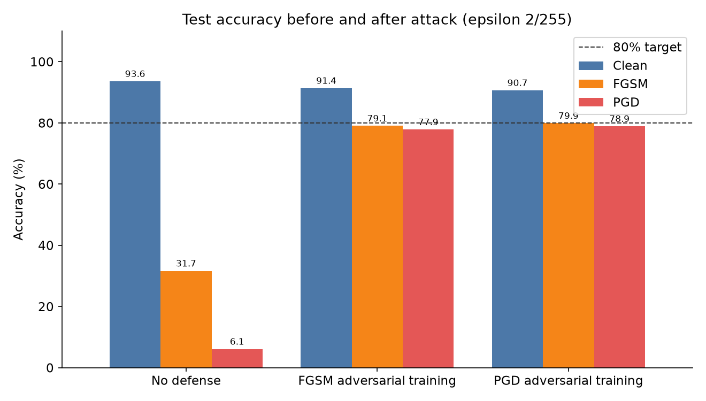
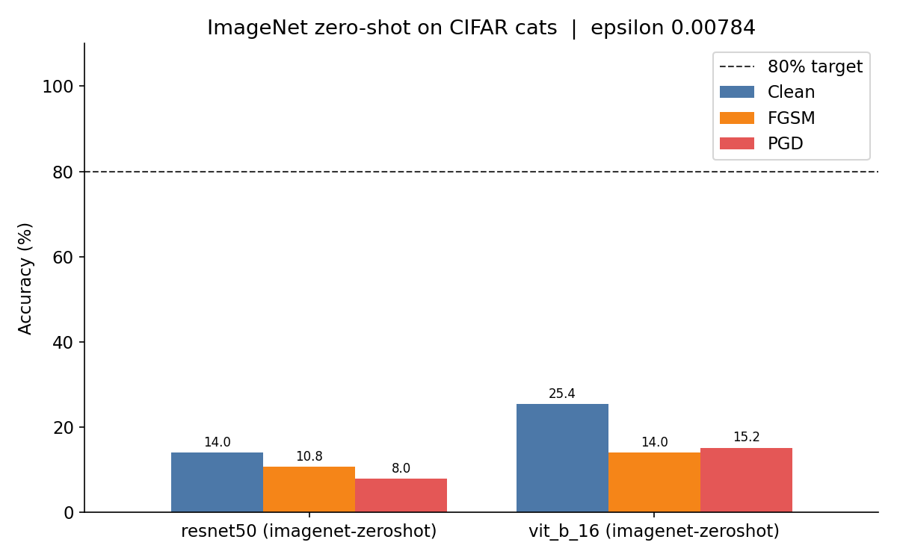
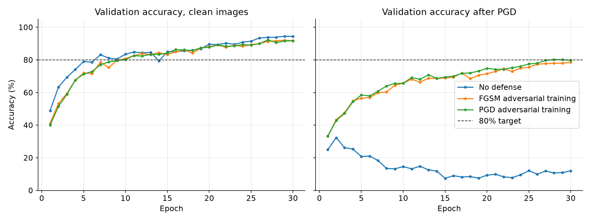
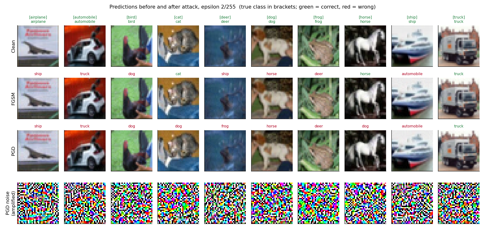
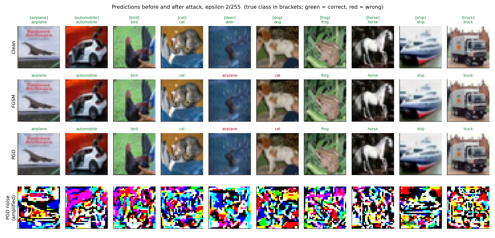
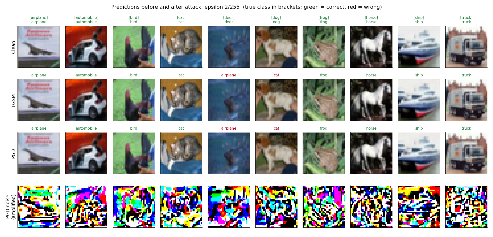
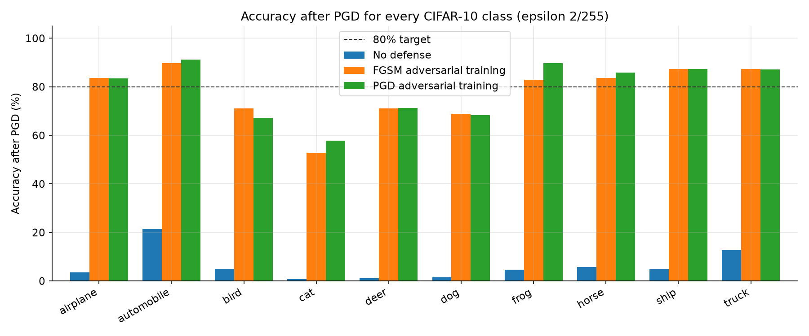
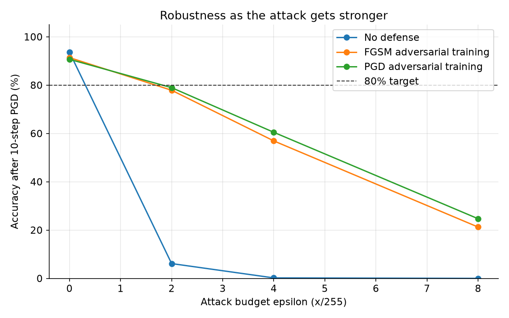

# Attack2Defense: Making a CIFAR-10 Classifier Robust to Adversarial Attacks


_This report is generated by `scripts/build_report.py` from the experiment outputs. Every number and figure below comes from those files._

## Summary

The goal was a classifier for all ten CIFAR-10 classes that stays **above 80% accuracy after an adversarial attack**. I attacked it with FGSM and a 10-step PGD attack, both limited to changing each pixel by at most 2/255.

Was the target met? **Not yet.** The best model, ResNet-18, PGD adversarial training, keeps **78.9%** correct under a 10-step PGD attack at epsilon 2/255. That is 1.1 points short of the 80% target.

Without a defense, the same architecture drops from 93.6% on clean images to 6.1% under PGD. Adversarial training raises accuracy under attack by **72.8 points**, at a cost of 3.0 points on clean images.

| Model | Clean | FGSM | PGD-10 | Drop under PGD | 80% target |
| --- | --- | --- | --- | --- | --- |
| ResNet-18, no defense | 93.6% | 31.7% | 6.1% | 87.5 pts | not met |
| ResNet-18, FGSM adversarial training | 91.4% | 79.1% | 77.9% | 13.5 pts | not met |
| ResNet-18, PGD adversarial training | 90.7% | 79.9% | 78.9% | 11.7 pts | not met |



## 1. Goal

| Week | Task |
| --- | --- |
| Last week | Data pipeline. Check that a cat image is classified as a cat, and see what happens after FGSM and PGD. Compare ResNet-50 and ViT-B/16. Read the attack literature. |
| This week | Build a training pipeline. Test on all CIFAR-10 classes. Find a defense that keeps accuracy above 80% after attacks. |

## 2. Starting point: last week's zero-shot experiment

Last week's script took ImageNet-pretrained ResNet-50 and ViT-B/16 and showed them CIFAR-10 cat images resized to 224x224. A prediction counted as correct when the ImageNet label was a kind of cat.

That experiment answered "can an attack fool a model?" (yes, easily), but it had three limits that made it unusable as a defense benchmark:

1. **No training.** The models never learned CIFAR-10, so accuracy measured ImageNet transfer rather than a CIFAR-10 classifier.
2. **One class.** Only cats were tested. A defense has to work for all ten classes.
3. **Uneven attack budget.** The perturbation was added after normalization. A step of 0.02 in normalized units is a different pixel change on the red, green, and blue channels, so "epsilon" did not mean a fixed number of intensity levels.

The rebuilt benchmark keeps that comparison (`python -m attack2defense benchmark`), with whole-word cat matching so "catamaran" no longer counts as a cat:

| Model | Cat images | Clean | FGSM | PGD |
| --- | --- | --- | --- | --- |
| ResNet-50 | 500 | 14.0% | 10.8% | 8.0% |
| ViT-B/16 | 500 | 25.4% | 14.0% | 15.2% |



## 3. Method

### 3.1 Threat model

Images are stored as pixels in [0, 1]. The normalization step is inside the model, so an attack edits real pixels. The attacker may change every pixel of every channel by at most **epsilon = 2/255** (two intensity levels out of 255), and the result is clipped back to a valid image. This is an untargeted L-infinity attack: the attacker wins if the prediction is anything other than the true label.

### 3.2 Attacks

- **FGSM** (Goodfellow et al., 2015) takes a single step of size epsilon in the direction of the sign of the loss gradient. It is fast but weak.
- **PGD** (Madry et al., 2018) starts from a random point inside the epsilon ball and takes 10 steps of size epsilon/4. After each step it projects back into the ball. PGD is the standard strong first-order attack, so **accuracy after PGD is the number that matters**.

Both attacks use the **true** CIFAR-10 label. Last week's script used the model's own prediction instead.

### 3.3 Defense: adversarial training

A normally trained network learns features that a tiny, carefully chosen perturbation can flip. Adversarial training replaces every training batch with attacked images, so the network is optimised for the worst case inside the epsilon ball:

> minimise over the weights the expected value of ( maximise over the perturbation, |perturbation| <= epsilon, of loss(image + perturbation) )

Two versions were compared:

| Defense | Inner attack per batch | Cost |
| --- | --- | --- |
| FGSM adversarial training (Wong et al., 2020) | Random start plus one step of 1.25 x epsilon | About 2x normal training |
| PGD adversarial training (Madry et al., 2018) | 5 PGD steps of epsilon/2 (step size 2.5 x epsilon / steps) | About 6x normal training |

One-step training can fail through *catastrophic overfitting*: the model learns to beat FGSM while PGD still breaks it. The training log watches for that gap. PGD training is the safer fallback.

### 3.4 Why ResNet-18 at 32x32 rather than ResNet-50 or ViT-B/16

ResNet-50 and ViT-B/16 expect 224x224 images, which means every 32x32 CIFAR image is upscaled 7x. Adversarial training multiplies the cost of every batch. The CIFAR variant of ResNet-18 (3x3 stem, no initial max-pool) works on native 32x32 images, is the standard architecture in CIFAR-10 robustness papers, and trains in minutes per epoch on a GPU. On the laptop CPU used for development, one adversarial epoch of ResNet-18 took about 100 minutes, so the full ResNet-18 runs use a Colab GPU. A small five-layer CNN (`small_cnn`) is the CPU option.

### 3.5 Evaluation protocol

- Training uses 49,000 CIFAR-10 training images. The other 1,000 (100 per class) are a validation split used only to choose the best checkpoint.
- Reported numbers use the official **10,000-image CIFAR-10 test set**, which training never sees.
- Classes: airplane, automobile, bird, cat, deer, dog, frog, horse, ship, truck.
- Clean, FGSM, and PGD-10 accuracy are measured overall and per class. The sweep then repeats the attacks at 4/255 and 8/255.

## 4. Setup

| Model | Epochs | Best epoch | Training time | Optimizer | Schedule |
| --- | --- | --- | --- | --- | --- |
| No defense | 30 | 29 | 13 min | sgd | onecycle |
| FGSM adversarial training | 30 | 30 | 16 min | sgd | onecycle |
| PGD adversarial training | 30 | 28 | 33 min | sgd | onecycle |

Models in this results set: ResNet-18. Number of runs: 3.

Training recipe:

- **No defense**: ResNet-18, trained on clean images; sgd at learning rate 0.1, weight decay 0.0005, onecycle schedule, batch 128, 30 epochs.
- **FGSM adversarial training**: ResNet-18, trained on FGSM-RS images at epsilon 2/255; sgd at learning rate 0.1, weight decay 0.0005, onecycle schedule, batch 128, 30 epochs.
- **PGD adversarial training**: ResNet-18, trained on 5-step PGD images at epsilon 2/255; sgd at learning rate 0.1, weight decay 0.0005, onecycle schedule, batch 128, 30 epochs.
- Every run uses random crops with 4-pixel padding and horizontal flips.



## 5. Results

### 5.1 Clean vs defended

| Model | Clean | FGSM | PGD-10 | Drop under PGD | 80% target |
| --- | --- | --- | --- | --- | --- |
| ResNet-18, no defense | 93.6% | 31.7% | 6.1% | 87.5 pts | not met |
| ResNet-18, FGSM adversarial training | 91.4% | 79.1% | 77.9% | 13.5 pts | not met |
| ResNet-18, PGD adversarial training | 90.7% | 79.9% | 78.9% | 11.7 pts | not met |

### 5.2 Before and after the attack: example images

Each grid shows the first test image of every class, with the true class in brackets. The rows are the clean image, the FGSM image, the PGD image, and the PGD perturbation amplified so it becomes visible. Titles are the model's prediction, **green when correct and red when wrong**. Every model sees exactly the same images.

| Model | Correct before attack | Correct after FGSM | Correct after PGD |
| --- | --- | --- | --- |
| No defense | 10 / 10 | 3 / 10 | 1 / 10 |
| FGSM adversarial training | 10 / 10 | 8 / 10 | 8 / 10 |
| PGD adversarial training | 10 / 10 | 8 / 10 | 8 / 10 |

**ResNet-18, no defense**



**ResNet-18, FGSM adversarial training**



**ResNet-18, PGD adversarial training**



The perturbation at 2/255 is invisible to a person: the clean and attacked columns look identical. No defense: 10 of 10 correct before the attack, 1 after PGD. FGSM adversarial training: 10 of 10 correct before the attack, 8 after PGD. PGD adversarial training: 10 of 10 correct before the attack, 8 after PGD.

### 5.3 Every CIFAR-10 class



| Class | No defense: clean | No defense: PGD | FGSM adversarial training: clean | FGSM adversarial training: PGD | PGD adversarial training: clean | PGD adversarial training: PGD |
| --- | --- | --- | --- | --- | --- | --- |
| airplane | 94.4% | 3.6% | 93.4% | 83.7% | 91.8% | 83.5% |
| automobile | 96.7% | 21.4% | 96.4% | 89.8% | 96.4% | 91.2% |
| bird | 92.1% | 5.0% | 89.7% | 71.0% | 83.7% | 67.2% |
| cat | 84.5% | 0.7% | 78.2% | 52.8% | 81.8% | 57.8% |
| deer | 96.0% | 1.2% | 91.4% | 71.1% | 89.4% | 71.2% |
| dog | 89.8% | 1.5% | 85.2% | 68.9% | 83.2% | 68.4% |
| frog | 95.6% | 4.6% | 96.1% | 82.9% | 96.7% | 89.7% |
| horse | 96.1% | 5.7% | 94.1% | 83.6% | 94.2% | 85.8% |
| ship | 95.8% | 4.8% | 95.0% | 87.4% | 94.5% | 87.4% |
| truck | 95.2% | 12.7% | 94.3% | 87.4% | 95.0% | 87.2% |

### 5.4 Stronger attacks



| Model | Clean | FGSM 2/255 | PGD 2/255 | FGSM 4/255 | PGD 4/255 | FGSM 8/255 | PGD 8/255 |
| --- | --- | --- | --- | --- | --- | --- | --- |
| No defense | 93.6% | 31.7% | 6.1% | 18.2% | 0.2% | 11.5% | 0.0% |
| FGSM adversarial training | 91.4% | 79.1% | 77.9% | 63.7% | 56.9% | 38.7% | 21.2% |
| PGD adversarial training | 90.7% | 79.9% | 78.9% | 65.7% | 60.5% | 40.9% | 24.7% |

The defense is tuned for 2/255. As epsilon grows, accuracy falls for every model. No defense goes from 93.6% clean to 0.0% under PGD at 8/255. FGSM adversarial training goes from 91.4% clean to 21.2% under PGD at 8/255. PGD adversarial training goes from 90.7% clean to 24.7% under PGD at 8/255. For context, at 8/255 (the budget used in most research papers), published single models trained specifically for 8/255 typically reach about 45-55% under strong attacks.

## 6. Conclusion

**Not yet.** The best model, ResNet-18, PGD adversarial training, keeps **78.9%** correct under a 10-step PGD attack at epsilon 2/255. That is 1.1 points short of the 80% target.

Without a defense, the same architecture drops from 93.6% on clean images to 6.1% under PGD. Adversarial training raises accuracy under attack by **72.8 points**, at a cost of 3.0 points on clean images.

What made the difference:

1. **Measuring the right thing.** Training on CIFAR-10, testing all ten classes, and attacking real pixels with the true label turned last week's demo into a benchmark.
2. **Training on attacks.** Adversarial training is the only change between the undefended and defended rows of the tables above.
3. **Matching the model to the data.** Training a 32x32 ResNet-18 instead of upscaling to 224x224 made adversarial training affordable.

## 7. Limitations and next steps

- **Budget-specific robustness.** The defense targets 2/255. To claim robustness at 8/255, train at 8/255 and expect lower clean accuracy.
- **First-order attacks only.** FGSM and PGD are gradient attacks. A stronger audit would add AutoAttack (APGD-CE, APGD-T, FAB, Square), which also catches gradient masking.
- **Clean accuracy cost.** Robust models give up some clean accuracy. TRADES or adding extra (pseudo-labelled) training data are the usual ways to close that gap.
- **Bigger models.** Wide ResNets (WRN-34-10) and longer schedules improve both clean and robust accuracy, at a higher compute cost.

## 8. How to reproduce

```bash
python scripts/package_for_colab.py               # builds attack2defense_project.zip
# run notebooks/run_experiments_colab.ipynb on a Colab GPU, download results.zip
python scripts/build_report.py --results results.zip
```

All raw numbers are in `docs/results_tables.md`, and per-run CSV and JSON files are in each run's `test_eval/` folder.

## References

1. I. Goodfellow, J. Shlens, C. Szegedy. *Explaining and Harnessing Adversarial Examples.* ICLR 2015.
2. A. Madry, A. Makelov, L. Schmidt, D. Tsipras, A. Vladu. *Towards Deep Learning Models Resistant to Adversarial Attacks.* ICLR 2018.
3. E. Wong, L. Rice, J. Z. Kolter. *Fast is Better than Free: Revisiting Adversarial Training.* ICLR 2020.
4. H. Zhang et al. *Theoretically Principled Trade-off between Robustness and Accuracy (TRADES).* ICML 2019.
5. F. Croce, M. Hein. *Reliable Evaluation of Adversarial Robustness with an Ensemble of Diverse Parameter-free Attacks (AutoAttack).* ICML 2020.
6. K. He, X. Zhang, S. Ren, J. Sun. *Deep Residual Learning for Image Recognition.* CVPR 2016.
7. A. Dosovitskiy et al. *An Image is Worth 16x16 Words: Transformers for Image Recognition at Scale.* ICLR 2021.
