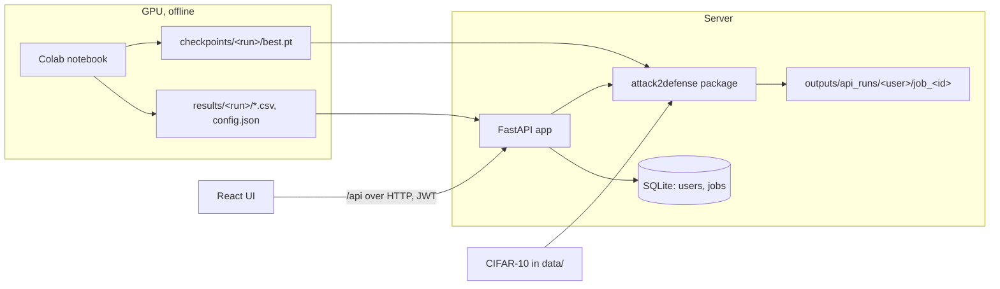
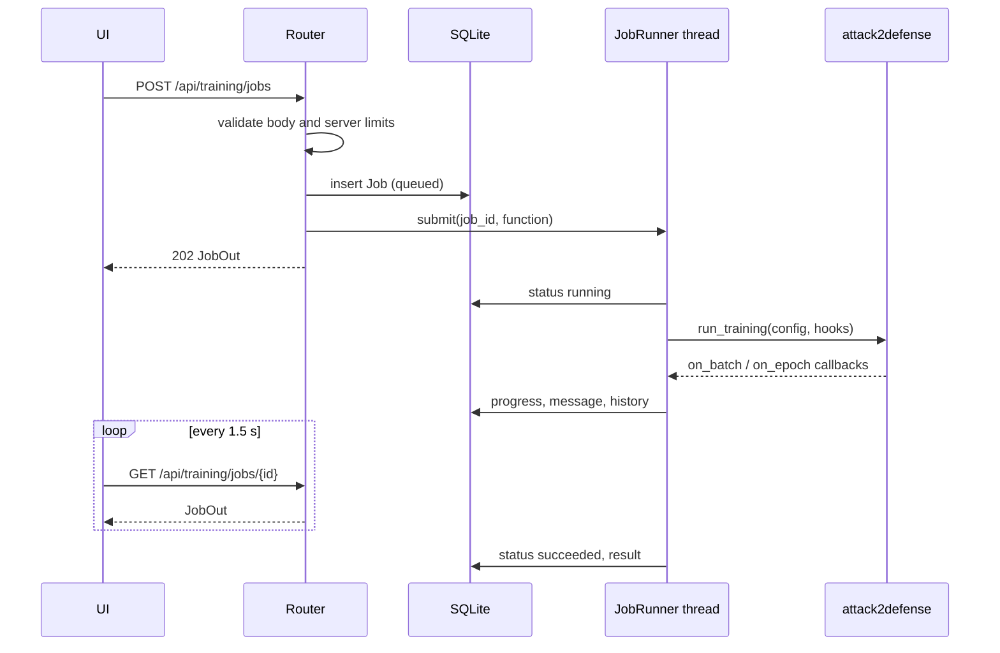

# Architecture

Attack2Defense has three layers. Each one only talks to the layer directly below it.

| Layer | Path | Responsibility | Depends on |
| --- | --- | --- | --- |
| ML package | `attack2defense/` | Data, models, FGSM and PGD, training, evaluation, randomized smoothing, CLI | PyTorch, torchvision, pandas |
| API | `backend/app/` | Accounts, model registry, background jobs, HTTP endpoints | The ML package, FastAPI, SQLAlchemy |
| UI | `frontend/` | Guided screens, charts, forms | The API over HTTP only |

The ML package has no knowledge of HTTP or users, so the CLI, the notebook and the API all run the same attack and training code. Anything the UI shows was computed by that package.

## 1. ML package (`attack2defense/`)

| Module | What it holds |
| --- | --- |
| `config.py` | CIFAR-10 class names, dataset statistics, `MODEL_SPECS` |
| `data.py` | Transforms, a stratified train/validation split, class-balanced test subsets, Imagenette loader |
| `models.py` | `PixelModel` (normalization inside the model), `SmallCIFARCNN`, CIFAR ResNet-18 (3x3 stem, no max-pool), ResNet-50 and ViT-B/16 for the zero-shot benchmark |
| `attacks.py` | `project`, `pgd_attack`, `fgsm_attack`, `fast_adversarial_example`, `run_attack` |
| `train.py` | `TrainConfig`, `run_training`, adversarial batch mixing, checkpoint selection, resume, `TrainingHooks` for progress and cancel |
| `evaluate.py` | `evaluate_loader` (clean, FGSM and PGD on the same images), `evaluate_sweep`, output files |
| `smoothing.py` | Gaussian noise, Monte Carlo voting, Clopper-Pearson bound, certified radius |
| `registry.py` | `discover_models`: merges checkpoints with result folders into one list of models |
| `setup_check.py` | `inspect_setup`: what is installed (dataset, results, weights) and what is missing |
| `cli.py` | `train`, `evaluate`, `compare`, `certify`, `benchmark`, `benchmark-attacks`, `doctor` |

### Design decisions

**Pixel-space threat model.** Every model is wrapped in `PixelModel`, which takes images in `[0, 1]` and normalizes them internally. An attack therefore edits real pixel intensities, and epsilon = 2/255 means "two brightness levels per channel". If normalization happened outside the model, the same epsilon would mean something different for each channel.

**One attack loop.** FGSM is `pgd_attack` with one step, step size epsilon and no random start. The fast-training variant is one step of `1.25 * epsilon` from a random start (Wong et al.). Because every attack shares the same code path, the projection and clipping are identical for all of them.

**Checkpoint selection.** After every epoch the model is validated on a held-out slice of the training set. For defended runs the score is PGD accuracy; for the clean run it is clean accuracy. `best.pt` is saved only when the score improves. The official test set is used only for the final report, so it never influences which checkpoint is kept.

**Catastrophic overfitting check.** One-step (FGSM) training can collapse, so that a model resists FGSM but not PGD. `run_training` logs a warning when validation FGSM accuracy is more than 20 points above PGD accuracy.

## 2. API (`backend/app/`)

| File | Responsibility |
| --- | --- |
| `main.py` | `create_app()` factory: builds `Services`, installs CORS and error handlers, mounts every router under `/api` |
| `settings.py` | `Settings` from `A2D_*` environment variables or `backend/.env` |
| `deps.py` | `Services` dataclass, `current_user` (required login) and `optional_user` |
| `db.py` | SQLAlchemy models `User` and `Job`; marks jobs interrupted by a restart as failed |
| `security.py` | bcrypt password hashes, HS256 JWT tokens |
| `errors.py` | `ApiError` and the single error shape `{"error": {"code", "message", "field"}}` |
| `schemas.py` | Pydantic request and response bodies, with validation messages written for people |
| `services/model_store.py` | Public models (refreshed every few seconds) plus each user's own runs; an LRU cache of loaded models |
| `services/datasets.py` | Dataset metadata, sample pages, class-balanced loaders |
| `services/jobs.py` | `JobRunner`: one background worker thread, progress updates, cancellation |
| `services/tasks.py` | The work done by training, evaluation and certification jobs |
| `services/imaging.py` | Tensor-to-PNG data URLs, perturbation and heatmap images, upload decoding |
| `routers/*.py` | One router per area; see [API.md](API.md) |

### Request lifecycle

Short requests (attacks, catalog) run in the request thread and return the result directly.

Long requests (training, evaluation, certification) follow the job pattern:

There is a single worker, because training and evaluation each use the whole CPU or GPU. Extra jobs wait in the queue. A cancel request sets a `threading.Event` that the training loop checks before every batch, so a job stops within one batch.

### Model registry

`discover_models` scans two kinds of folders and merges them by folder name:

- `checkpoint_roots` (default `checkpoints/` and `outputs/cpu_preview/`) for `<run>/best.pt`
- `results_roots` (default `results/`) for `<run>/config.json` and the summary CSVs

A model with both is **live**: it can be attacked and evaluated. A model with only results still appears on the Dashboard with its reported numbers. A user's own training runs live in `outputs/api_runs/<user_id>/job_<id>/` and are visible only to that user. Other folders, such as `outputs/smoke/`, are never scanned.

### Security

- Passwords are hashed with bcrypt. Tokens are HS256 JWTs signed with `A2D_SECRET_KEY` and valid for 12 hours by default.
- Read-only endpoints (results, setup status, datasets, model list) are public. Anything that spends compute (attacks, training, evaluation, certification) needs a login.
- Requesting another user's job returns 404 rather than 403, so job ids do not leak.
- Server-side limits (`max_attack_batch`, `max_train_epochs`, `max_train_batches`, `max_eval_images_per_class`) keep a CPU-only server responsive.

## 3. UI (`frontend/`)

Vite, React 19, TypeScript, Tailwind CSS v4, Recharts, Axios and React Router 7.

| Path | Responsibility |
| --- | --- |
| `src/api/client.ts` | Axios instance, bearer token from `localStorage["a2d.token"]`, error normalization |
| `src/api/endpoints.ts`, `types.ts` | Typed wrappers for every endpoint |
| `src/auth/` | `AuthContext` and `RequireAuth` |
| `src/lib/setup.tsx` | `SetupProvider`: loads `/api/setup` once; the first-visit flag `a2d.seenGuide` |
| `src/lib/glossary.ts` | Plain-English definitions used by every `InfoTip` |
| `src/lib/results.ts` | Picks the headline baseline and defended models |
| `src/components/ui.tsx` | Design-system primitives: buttons, cards, `Segmented`, `Slider`, `InfoTip`, `Notice`, `EmptyState` |
| `src/components/charts.tsx`, `AccuracyTrack.tsx` | Dark-theme charts and the headline accuracy bars |
| `src/components/Layout.tsx` | Grouped sidebar, mobile drawer, setup status dot |
| `src/pages/*` | One file per screen, lazily loaded |

### Screens and routes

| Route | Screen | Login |
| --- | --- | --- |
| `/guide` | Start here: the story, four stages, glossary, setup status | No |
| `/` | Dashboard: reported results, examples, sweeps | No |
| `/attack` | Attack lab: three-step attack, explanation, compare two models | Yes |
| `/training` | Train a model with a chosen defense | Yes |
| `/evaluation` | Compare models on the same images and budgets | Yes |
| `/certified` | Randomized smoothing certification | Starting jobs only |
| `/models` | Models and data: model cards, dataset browser | No |
| `/login` | Log in or create an account | No |

On a first visit, `/` redirects to `/guide`. Opening the guide sets `a2d.seenGuide`, after which `/` shows the Dashboard.

### Design system

The dark theme is defined once as Tailwind `@theme` tokens in `src/index.css` and mirrored in `src/lib/tokens.ts` for charts. Colour always carries the same meaning:

| Token | Hex | Meaning |
| --- | --- | --- |
| `clean` | `#2dd4bf` | Clean images, a defense, a prediction that held |
| `adv` | `#ff5c93` | An attack, a prediction that was fooled |
| `warn` | `#f5b84a` | The robustness target, warnings |
| `base` / `surface` / `raised` | `#0b0f17` / `#121826` / `#1a2233` | Background layers |

Text is IBM Plex Sans, headings are Archivo, and numbers use a monospace font so columns line up.

**Light mode.** `:root[data-theme="light"]` in `index.css` overrides the same tokens with a light palette (accents darkened for contrast on white), and `palettes.light` in `tokens.ts` mirrors it for charts. `src/lib/theme.tsx` holds the choice (`localStorage["a2d.theme"]`, defaulting to the system preference), and a small script in `index.html` applies it before the first paint so there is no flash.

## 4. Data on disk

| Path | Written by | Contents |
| --- | --- | --- |
| `data/` | torchvision | CIFAR-10 (downloaded on first use) |
| `checkpoints/<run>/best.pt` | Colab, `install_checkpoints.py` | Reported ResNet-18 weights |
| `results/results/<run>/` | Colab | `config.json`, `history.csv`, `test_eval/`, `sweep.csv`, `certify.csv` |
| `outputs/cpu_preview/<run>/` | CLI | Small CNN demo models |
| `outputs/api_runs/<user>/job_<id>/` | Training jobs | Per-user runs |
| `backend/attack2defense.db` | API | Users and jobs |
| `docs/figures/` | `scripts/build_report.py` | Report figures |

A checkpoint is a dictionary with `backbone` (state dict), `config`, `epoch`, `best_score` and the optimizer, scheduler and scaler state used for resuming.
