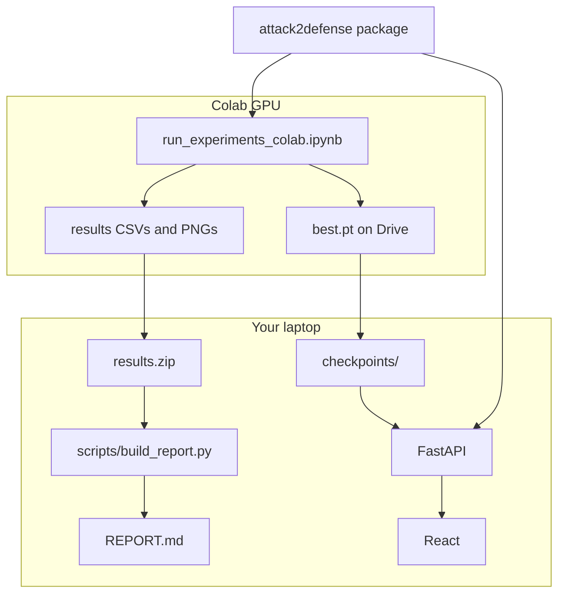

# Attack2Defense — Evaluation & Viva Guide

**Purpose:** Use this document when someone asks you to open a file, run the project, or explain how everything connects. It follows the project from start to finish: what was built, why, and how it works at a deeper level.

**Related docs:** [README.md](../README.md) (quick start) · [REPORT.md](../REPORT.md) (numbers and figures) · [USER_GUIDE.md](USER_GUIDE.md) (every screen) · [ARCHITECTURE.md](ARCHITECTURE.md) · [API.md](API.md) · [prd_checklist.md](prd_checklist.md) (PRD mapping)

---

## 1. The story in one minute

You built an **adversarial robustness workbench** for **CIFAR-10** (10 small image classes). The question is: can a classifier stay accurate when an attacker adds a **tiny, invisible perturbation** to each pixel?

- **Attack:** FGSM (one gradient step) and PGD (many steps, stronger).
- **Defense:** **Adversarial training** — train on attacked images so the model learns to resist them.
- **Threat model:** L-infinity, epsilon = **2/255** per pixel, untargeted, using the **true label** (not the model’s guess).
- **Delivery:** A Python package (`attack2defense`), a **FastAPI** backend, a **React** frontend, Colab for GPU training, and **REPORT.md** with real numbers.

**Your headline result (ResNet-18, 10k test set, PGD-10 at 2/255):**

| Setup | Clean | After PGD |
| --- | --- | --- |
| No defense | 93.6% | 6.1% |
| PGD adversarial training | 90.7% | **78.9%** (target was 80%; 1.1 pts short) |

---

## 2. Process from start to end

### Phase A — Last week (exploration)

1. **Data:** CIFAR-10 images in [0, 1] pixel space.
2. **Zero-shot check:** ImageNet **ResNet-50** and **ViT-B/16** on **cat** images only (`zeroshot.py`, old `OJT.ipynb`).
3. **Lesson:** Attacks work, but one class and no CIFAR training is not a defense benchmark.

### Phase B — Core ML pipeline (this week)

1. **Package** `attack2defense/` with train / attack / evaluate.
2. **Train three models on Colab GPU** (30 epochs, ResNet-18):
   - `resnet18_clean` — normal training.
   - `resnet18_fgsm` — fast adversarial training (FGSM-RS).
   - `resnet18_pgd` — PGD adversarial training (5 inner steps).
3. **Evaluate** on official **10,000** test images; **sweep** 2/255, 4/255, 8/255.
4. **Zip** results → `results.zip` → `python scripts/build_report.py` → **REPORT.md** + figures.

### Phase C — Product (PRD)

1. **Backend:** login, datasets, models, attack endpoints, training/evaluation **jobs**, export CSV/JSON.
2. **Frontend:** Start here guide, Dashboard, Attack lab, Training, Evaluation, Certified defense, Models and data.
3. **Extras:** Imagenette, randomized smoothing (`certify`), CW/AutoAttack (`benchmark-attacks`).
4. **Tests + CI** on GitHub.

### Phase D — Usability and documentation

1. **Dark "security lab" redesign:** teal = clean/defended, pink = attack/fooled, amber = target. Grouped navigation, mobile drawer.
2. **Guided walkthrough:** first visit lands on Start here; every technical term has a "?" definition.
3. **Attack lab:** three steps (model, image, attack), strength presets, a plain-English explanation, compare two models side by side.
4. **Presets** on Training, Evaluation and Certified defense, with time estimates.
5. **Setup check:** `python -m attack2defense doctor`, `GET /api/setup`, the sidebar status dot, and `scripts/install_checkpoints.py` for downloaded weights.
6. **Docs:** ARCHITECTURE, API, USER_GUIDE, DEVELOPMENT, CHANGELOG.



---

## 3. How the three layers connect

| Layer | Folder | Role | Depends on |
| --- | --- | --- | --- |
| ML core | `attack2defense/` | Attacks, training, metrics, plots | PyTorch, CIFAR-10 |
| API | `backend/app/` | HTTP, auth, jobs, JSON + base64 images | `attack2defense` |
| UI | `frontend/src/` | Screens, sliders, charts | API only |

**Rule:** The UI never imports PyTorch. The API never reimplements PGD; it calls `run_attack`, `run_training`, `evaluate_sweep`, etc.

**Typical Attack lab request:**

1. Browser → `POST /api/attacks/pgd` with `model_id`, `sample_indices`, `epsilon`, `steps`.
2. `attacks.py` router → `ModelStore.load()` → `run_attack()` in `attack2defense/attacks.py`.
3. Response: clean PNG, adversarial PNG, heatmap, predictions, `success_per_step`, `seconds`.

---

## 4. Deep dive: why pixel space and `PixelModel`

**Problem in last week’s notebook:** perturbation after **normalization** means “epsilon” is not the same on R, G, B.

**Fix in `models.py` — `PixelModel`:**

- Input to the network wrapper: pixels in **[0, 1]**.
- Inside `forward`: `(pixels - mean) / std`, then the backbone (ResNet-18, etc.).
- Attacks in `attacks.py` change **pixels** directly; epsilon **2/255** = two intensity levels on every channel.

**If they open `models.py`, say:** “Normalization is inside the module so FGSM and PGD edit real pixel values and the threat model matches the paper’s L-infinity ball in image space.”

---

## 5. Deep dive: FGSM and PGD

**File:** `attack2defense/attacks.py`

| Function | What it does |
| --- | --- |
| `project()` | Clip perturbation to L-infinity ball around original, then clip to [0, 1]. |
| `fgsm_attack()` | One step: `x + epsilon * sign(grad loss)`. |
| `pgd_attack()` | Random start in ball (optional), repeat: forward → grad → step → **project**. |
| `craft_adversarial_examples()` | Used in training/eval: kinds `fgsm`, `fgsm_rs`, `pgd` with Madry step size `2.5 * epsilon / steps`. |
| `run_attack()` | Wraps PGD loop, records **time** and **success_per_step** (fraction misclassified after each step). |

**Loss uses `reduction="sum"`** so gradients stay large enough under mixed precision (AMP).

**If they open `attacks.py`, say:** “FGSM is one signed step; PGD is projected gradient ascent on cross-entropy with the true label. Every step we project back into the epsilon ball and valid image range.”

**Sanity check:** `tests/test_reference_attacks.py` compares to **torchattacks** on a tiny model.

---

## 6. Deep dive: training and defense

**File:** `attack2defense/train.py`

**Modes (`TrainConfig.mode`):**

| Mode | What each batch sees |
| --- | --- |
| `clean` | Original images only. |
| `fgsm` | **FGSM-RS** (random start + 1.25×epsilon step) — Wong et al. fast AT. |
| `pgd` | **5-step PGD** examples per batch — Madry-style AT. |
| `gaussian` | Gaussian noise (for randomized smoothing training, not empirical PGD defense). |

**`adv_ratio`:** Only the first fraction of each batch is replaced with adversarial images; rest stays clean (PRD hyperparameter).

**Checkpoint selection:** Best `best.pt` by **validation PGD accuracy** (for defended runs) or **clean accuracy** (for `clean` mode). Validation = 100 images per class held out from train.

**Outputs per run folder:** `config.json`, `train.log`, `history.csv`, `best.pt`, `last.pt`, `test_eval/` (after final eval).

**If they open `train.py`, say:** “Training loop uses AMP on GPU, OneCycle or cosine scheduler, and `_training_inputs` to swap in adversarial batches. Catastrophic overfitting is warned when val FGSM ≫ val PGD in fgsm mode.”

---

## 7. Deep dive: evaluation and reporting

**File:** `attack2defense/evaluate.py`

- **`evaluate_loader`:** For each batch: clean acc, FGSM acc, PGD acc (true labels for attacks).
- **`run_evaluation`:** Loads checkpoint, runs test loader, writes `summary.csv`, `per_class.csv`, `metrics.json`, plots, optional **attack example grid**.
- **`evaluate_sweep`:** Same metrics at multiple epsilons; **`flag_below_threshold`** marks FGSM/PGD below user threshold (default 80%).
- **`export_results`:** CSV or JSON.

**File:** `scripts/build_report.py`

- Reads `*/test_eval/summary.csv` from `results.zip` or folder.
- Fills `docs/report_template.md` → **REPORT.md**, copies figures to `docs/figures/`, updates README results block.

**If they open `evaluate.py`, say:** “We never tune on the 10k test set during training; that split is only for the report. Attacks always use ground-truth labels for a standard white-box benchmark.”

---

## 8. File-by-file: `attack2defense/` (open any file → explain)

| File | What was written | Why | How it connects |
| --- | --- | --- | --- |
| `config.py` | Class names, CIFAR/ImageNet mean/std, `TARGET_EPSILON`, `ROBUST_ACCURACY_TARGET`, `MODEL_SPECS` | Single source of constants | Used by data, models, train, evaluate |
| `data.py` | `load_cifar10`, `load_imagenette`, `load_dataset`, stratified split, `make_test_loader` | Reproducible splits; PRD datasets | Called from `train.py`, API `DatasetService` mirrors test set |
| `models.py` | `PixelModel`, `SmallCIFARCNN`, ResNet-18 CIFAR stem, ImageNet loaders | Correct input size and pixel-space attacks | `build_pixel_model`, `restore_model` |
| `attacks.py` | FGSM, PGD, `run_attack` | Core paper algorithms + PRD trace/timing | CLI, API `routers/attacks.py`, `evaluate.py` |
| `train.py` | `run_training`, hooks for cancel/progress | Full training pipeline | CLI `train`, API `services/tasks.py` |
| `evaluate.py` | Test metrics, sweep, export | PRD evaluation | CLI `evaluate`, API evaluation jobs |
| `plotting.py` | Bar charts, example grids, certified curve | Report and UI figures | evaluate, build_report, smoothing |
| `registry.py` | Scan `checkpoints/` + `results/` | Model cards in API | `ModelStore`, public results |
| `setup_check.py` | `inspect_setup`: dataset, results, weights, missing paths | Tell users exactly what is missing | CLI `doctor`, API `GET /api/setup` |
| `smoothing.py` | Noise, certify, Clopper-Pearson | US-08 stretch | CLI `certify`, API `/certify` |
| `extra_attacks.py` | CW, AutoAttack via torchattacks | Optional strong audit | CLI `benchmark-attacks` |
| `zeroshot.py` | ResNet-50 vs ViT on cats | Last week benchmark | CLI `benchmark` |
| `cli.py` | Subcommands: train, evaluate, compare, benchmark, certify, benchmark-attacks, doctor | Reproducible CLI | Entry: `python -m attack2defense` |
| `utils.py` | Device, seed, checkpoint load, tqdm | Shared infrastructure | Everywhere |
| `__main__.py` | Calls `cli.main()` | `python -m attack2defense` | — |

---

## 9. File-by-file: `backend/app/`

| File | What to say if opened |
| --- | --- |
| `main.py` | “Factory `create_app`: wires CORS, error handlers, mounts routers under `/api`, holds `Services` in app state.” |
| `settings.py` | “`A2D_*` env vars: DB path, checkpoint roots, CORS, limits on batch size and train epochs for CPU safety.” |
| `db.py` | “SQLAlchemy models: User, Job. SQLite file stores who ran what.” |
| `security.py` | “bcrypt passwords, JWT create/verify.” |
| `auth.py` router | “Register/login returns bearer token; `/me` for profile.” |
| `deps.py` | “`current_user` dependency: no token → 401 on protected routes.” |
| `errors.py` | “All errors → `{ error: { code, message, field } }` for the React client.” |
| `schemas.py` | “Pydantic: `AttackRequest`, `TrainingRequest`, `EvaluationRequest`, epsilon validators.” |
| `services/model_store.py` | “Loads `best.pt`, caches model on GPU/CPU, merges registry metadata.” |
| `services/datasets.py` | “CIFAR-10 test set in memory; returns tensors and base64 for UI.” |
| `services/jobs.py` | “Background thread runs training/eval; updates progress in DB.” |
| `services/tasks.py` | “Thin wrappers calling `run_training`, `evaluate_sweep`, `certify_loader`.” |
| `services/imaging.py` | “Tensor ↔ PNG base64, perturbation heatmap scaling.” |
| `routers/attacks.py` | “Calls `run_attack`, builds `AttackResponse` with images and trace.” |
| `routers/training.py` | “202 Accepted job; limits epochs/batches for laptop demos.” |
| `routers/evaluations.py` | “Multi-model sweep; `/export` CSV or JSON.” |
| `routers/certify.py` | “Certification job; separate from FGSM/PGD metrics.” |
| `routers/public.py` | “No login: model summaries from `results/`, zeroshot CSV, certify curves.” |
| `routers/models.py` | “List/detail/history; optional `examples.png` from test_eval.” |
| `routers/jobs_common.py` | “Shared create/list/cancel for job kinds.” |
| `routers/setup.py` | “Public `GET /api/setup`: what is installed, which weights are missing, which device the server uses.” |

---

## 10. File-by-file: `frontend/src/`

| File | What to say if opened |
| --- | --- |
| `main.tsx` | “React root, router, AuthProvider, ToastProvider.” |
| `App.tsx` | “Routes, wrapped in `SetupProvider`. First visit to `/` redirects to `/guide`. Attack/Training/Evaluation need login via `RequireAuth`.” |
| `index.css` | “Dark theme as Tailwind `@theme` tokens; colour carries meaning (teal clean, pink attack, amber target).” |
| `api/client.ts` | “Axios + JWT header; `toProblem()` maps API errors to user-readable messages.” |
| `api/endpoints.ts` | “One function per API route.” |
| `auth/AuthContext.tsx` | “Stores token in localStorage; login/register/me.” |
| `lib/setup.tsx` | “Loads `/api/setup` once for the status dot and checklist; remembers that the guide was seen.” |
| `lib/glossary.ts` | “Plain-English definitions shown by every `?` InfoTip.” |
| `components/ui.tsx` | “Design system: buttons, cards, `Segmented` radio group, `Slider`, `InfoTip`, `Notice`, `EmptyState`.” |
| `pages/Guide.tsx` | “Start here: the result in three bars, four stages, glossary, setup status.” |
| `pages/Overview.tsx` | “Dashboard: calls `/api/public/results`; headline numbers, examples, results table, sweep.” |
| `pages/AttackLab.tsx` | “Three steps; settings debounced 300 ms → PGD/FGSM; verdict, explanation, compare mode, batch check.” |
| `pages/Training.tsx` | “Defense picker and presets; polls job status; `TrainingCurves` from `history` in job.” |
| `pages/Evaluation.tsx` | “Multi-model, multi-epsilon; flags below threshold; export buttons.” |
| `pages/Certified.tsx` | “Tested vs proven explanation; randomized smoothing job + reported curves.” |
| `pages/ModelsData.tsx` | “Model cards (Live / Results only), training history, dataset browser.” |
| `components/charts.tsx` | “Recharts: accuracy vs epsilon, training curves, PGD success per step, certified curve.” |
| `components/Layout.tsx` | “Grouped sidebar (Learn, Experiment, Data), setup status dot, mobile drawer, login/logout.” |

**Vite proxy:** `frontend/vite.config.ts` proxies `/api` → `http://127.0.0.1:8000`.

---

## 11. Scripts, notebooks, tests

| Path | Purpose |
| --- | --- |
| `scripts/package_for_colab.py` | Zip source (no data/weights) → upload to Colab |
| `notebooks/run_experiments_colab.ipynb` | GPU: train 3 models, sweep, compare, zeroshot, optional extras, zip results |
| `scripts/build_report.py` | `results.zip` → REPORT + figures + README results |
| `tests/test_attacks.py` | Perturbation stays in epsilon ball |
| `tests/test_pipeline.py` | Train modes, checkpoint round-trip, eval files |
| `tests/test_reference_attacks.py` | Match torchattacks |
| `tests/test_evaluation_tools.py` | adv_ratio, registry, export, sweep flags |
| `tests/test_smoothing.py` | Certified math smoke tests |
| `tests/api/*.py` | Auth, attacks JSON shape, job lifecycle, certify |

---

## 12. How to run everything

### 12.1 One-time setup

```bash
cd Attack2Defense
python -m pip install torch torchvision --index-url https://download.pytorch.org/whl/cpu
python -m pip install -e ".[api,dev]"
cd frontend && npm install && cd ..
```

Check what is installed, then install any downloaded weights (see [checkpoints.md](checkpoints.md)):

```bash
python -m attack2defense doctor
python scripts/install_checkpoints.py path/to/downloads   # folder or .zip with best.pt files
```

Keep `results/` from Colab for the public demo metrics.

### 12.2 Full stack app

**Terminal 1 — API:**

```bash
python -m uvicorn backend.app.main:create_app --factory --reload --port 8000
```

**Terminal 2 — UI:**

```bash
cd frontend
npm run dev
```

Open http://localhost:5173. The first visit opens **Start here**, which explains the project and shows the setup checklist. Then: Register → Attack lab / Training / Evaluation. Every screen is described in [USER_GUIDE.md](USER_GUIDE.md).

### 12.3 CLI only (no website)

```bash
# Quick CPU demo (~minutes)
python -m attack2defense train --model small_cnn --mode fgsm --epochs 3
python -m attack2defense evaluate --checkpoint outputs/defense/best.pt --pgd-steps 10

# Full GPU recipe (Colab or local CUDA)
python -m attack2defense train --model resnet18 --mode pgd --optimizer sgd --lr 0.1 \
  --scheduler onecycle --epochs 30 --output-dir outputs/resnet18_pgd
python -m attack2defense evaluate --checkpoint outputs/resnet18_pgd/best.pt --sweep --threshold 0.8
```

### 12.4 Regenerate report from Colab output

```bash
python scripts/build_report.py --results results.zip
```

### 12.5 Tests (good to run before viva)

```bash
python -m pytest tests -q
cd frontend && npm test && npm run build
```

---

## 13. Data flow cheat sheet (memorize)

1. **Train:** CIFAR train 49k → (optional adversarial batch) → forward → loss → SGD/AdamW → val every epoch → save `best.pt`.
2. **Attack (inference):** image [0,1] → requires_grad → maximize CE(true label) → sign grad → project.
3. **Eval:** test loader → for each epsilon: clean / FGSM / PGD accuracy → CSV + plots.
4. **App attack:** same as (2) but one or few indices; encode images as base64 for browser.

---

## 14. What to say about results and limitations

**Say:**

- Undefended model is **excellent on clean** (93.6%) but **fails under PGD** (6.1%) at 2/255.
- PGD adversarial training **recovers 78.9%** under the same attack (+72.8 points) for ~3 points clean cost.
- Target **80%** missed by **1.1 points**. Validation PGD accuracy plateaued near 80% from epoch 27 (it uses a weaker 3-step PGD), so a wider network or extra data is the likelier fix than more epochs.
- Defense is **budget-specific** (trained/evaluated at 2/255); at 8/255 robust accuracy drops (see sweep in REPORT).
- **Certified** smoothing gives **provable** L2 radius; it is **not** the same as empirical PGD accuracy.
- **Zero-shot** ImageNet models on cats show transfer is weak; real benchmark is **trained CIFAR ResNet-18**.

**Do not claim:** adaptive attacks, production security, or 80% target met.

---

## 15. Quick viva Q&A

| Question | Short answer |
| --- | --- |
| Why PGD for evaluation if you trained with FGSM? | FGSM-AT is faster; PGD at test time is the standard **strong** attack; we report both. Best defense here is PGD-AT. |
| Why true label for attack? | Standard **white-box untargeted** benchmark; matches Madry et al. |
| What is epsilon 2/255? | Max change per pixel per channel = 2/255 ≈ 0.00784 in [0,1]. |
| Where is normalization? | Inside `PixelModel`, not in the dataloader. |
| How does the app stay secure? | JWT per user; jobs scoped to user; no stack traces to client. Not production WAF/rate limits (out of scope). |
| What is `adv_ratio`? | Fraction of each training batch replaced by adversarial examples; rest clean. |
| Difference FGSM-RS vs PGD training? | FGSM-RS: 1 random step per batch (~2× cost). PGD-AT: 5 steps (~6× cost), usually more robust. |
| What files prove reproducibility? | `config.json`, `history.csv`, `summary.csv`, seeded split in `data.py`, `scripts/build_report.py` from CSVs only. |

---

## 16. Export this document as PDF

This file is Markdown. Options on your machine:

**Option A — VS Code / Cursor:** Open `docs/EVALUATION_GUIDE.md` → Print → “Save as PDF”.

**Option B — Project script (already generated in repo):**

```bash
python -m pip install markdown xhtml2pdf
python scripts/md_to_pdf.py
```

Output: `docs/EVALUATION_GUIDE.pdf`. Arrows and symbols such as → and ≈ are printed as `->` and `~`, because the PDF fonts cannot draw them.

**Option C — Pandoc (if installed):**

```bash
pandoc docs/EVALUATION_GUIDE.md -o docs/EVALUATION_GUIDE.pdf
```

**Option D — Browser:** Open the `.md` in Cursor → Print → Save as PDF.

---

## 17. Checklist before evaluation

- [ ] Can start API + frontend and log in
- [ ] `python -m attack2defense doctor` shows what is installed
- [ ] Can walk through Start here → Attack lab (compare mode) → Dashboard
- [ ] Know where `checkpoints/` and `results/` live
- [ ] Can open `attacks.py` and explain `project` + PGD loop
- [ ] Can open `train.py` and explain three modes + `best.pt` selection
- [ ] Can quote **93.6 → 6.1 → 78.9** and 80% gap
- [ ] Know Colab notebook name and `build_report.py` command
- [ ] Skim [REPORT.md](../REPORT.md) figures (before/after grid, per-class, epsilon sweep)

---

*Document version: matches repository on main branch after full-stack PRD implementation. Update the results table if you rerun Colab with new checkpoints.*
