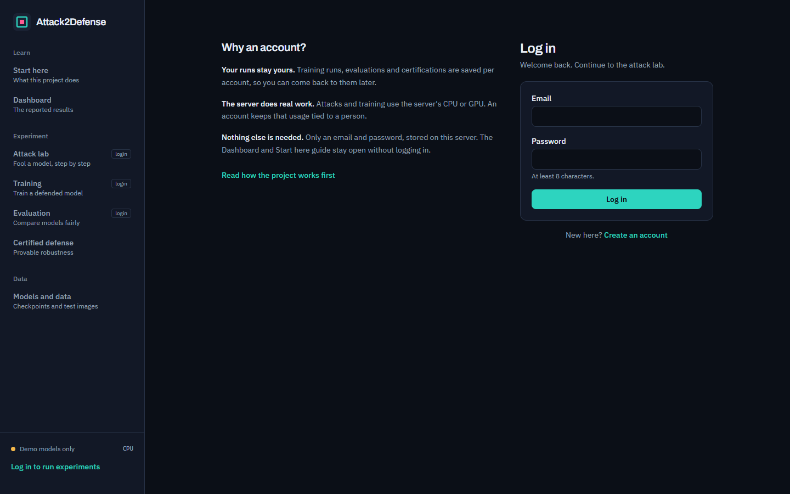
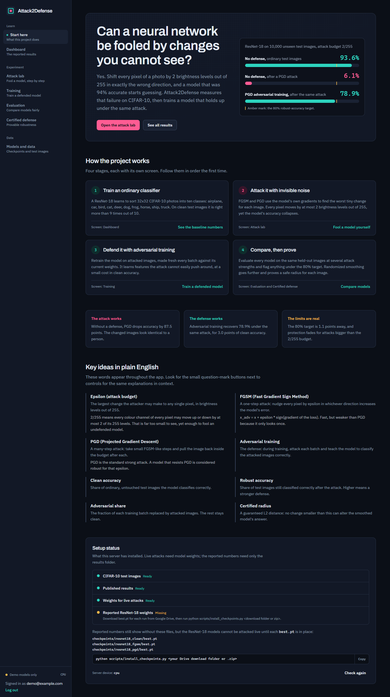
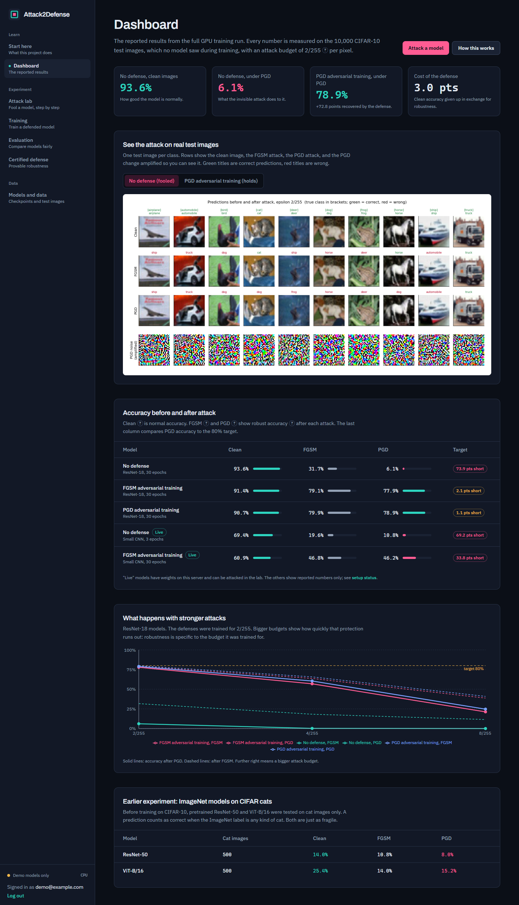
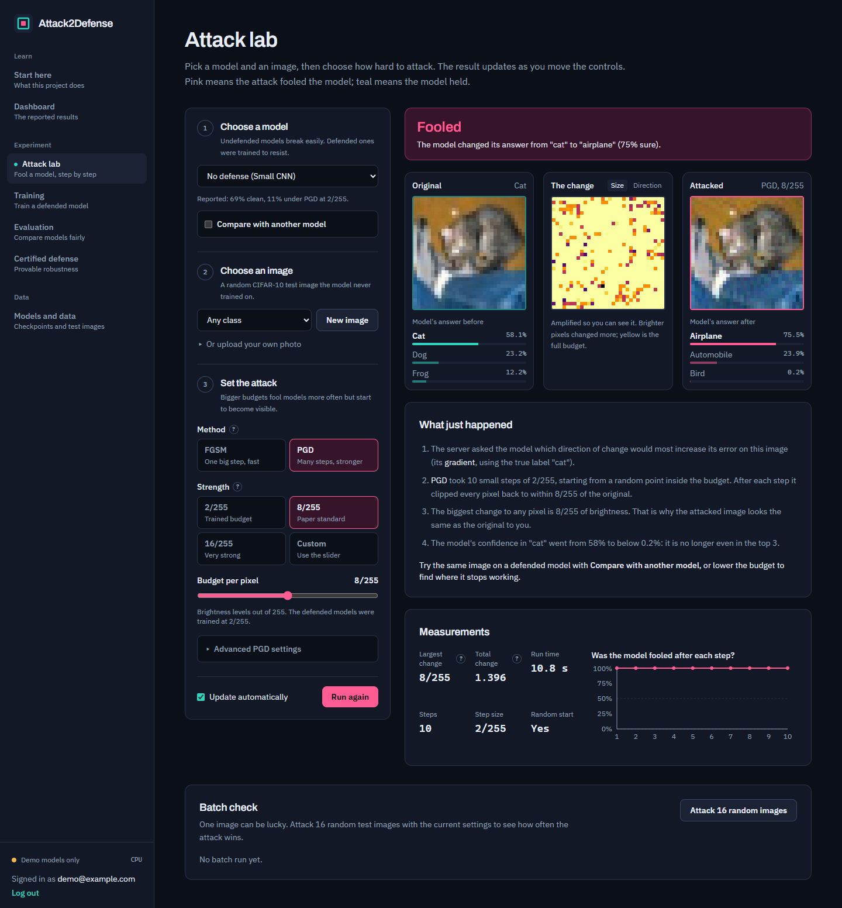
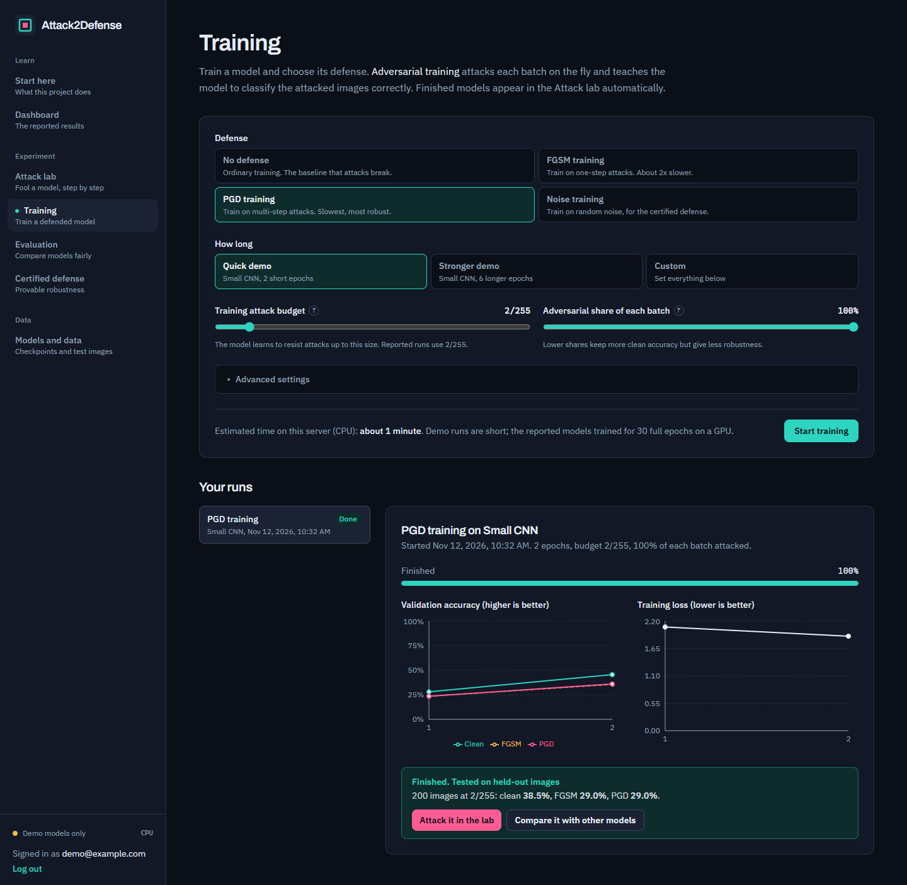
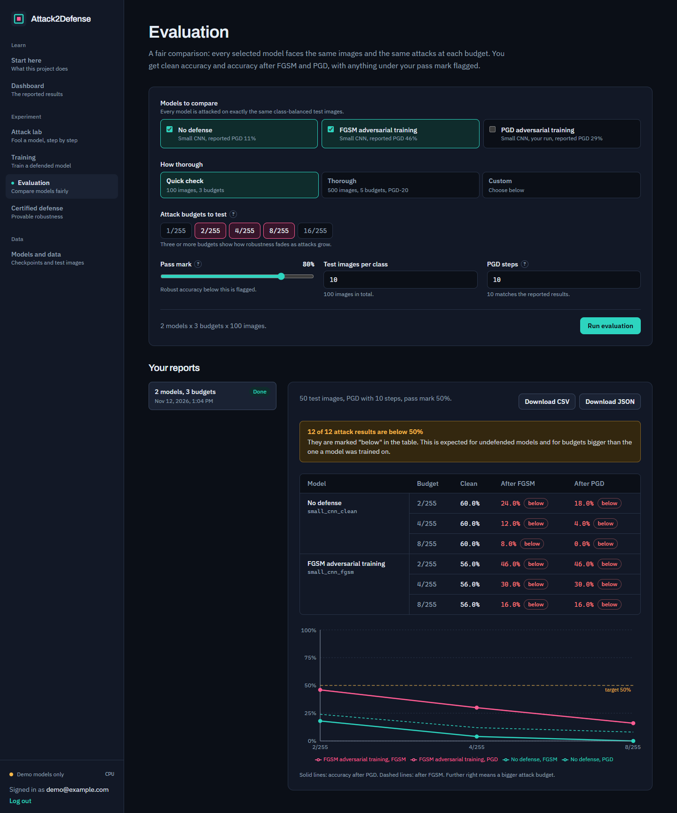
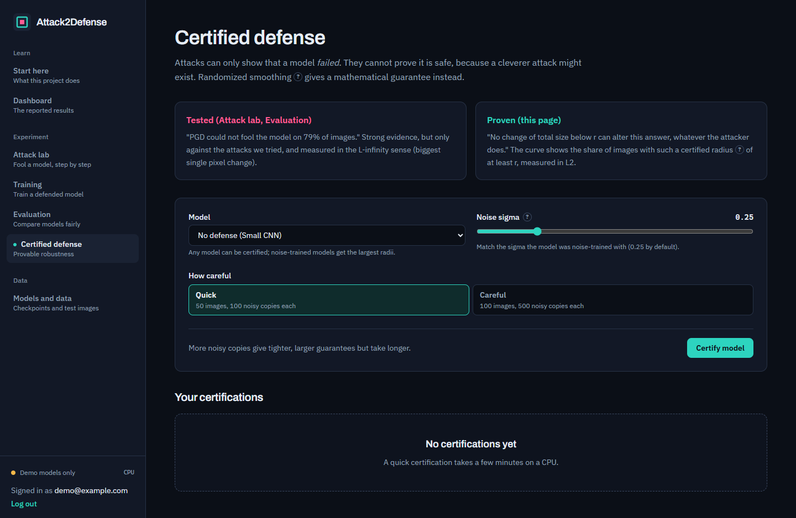
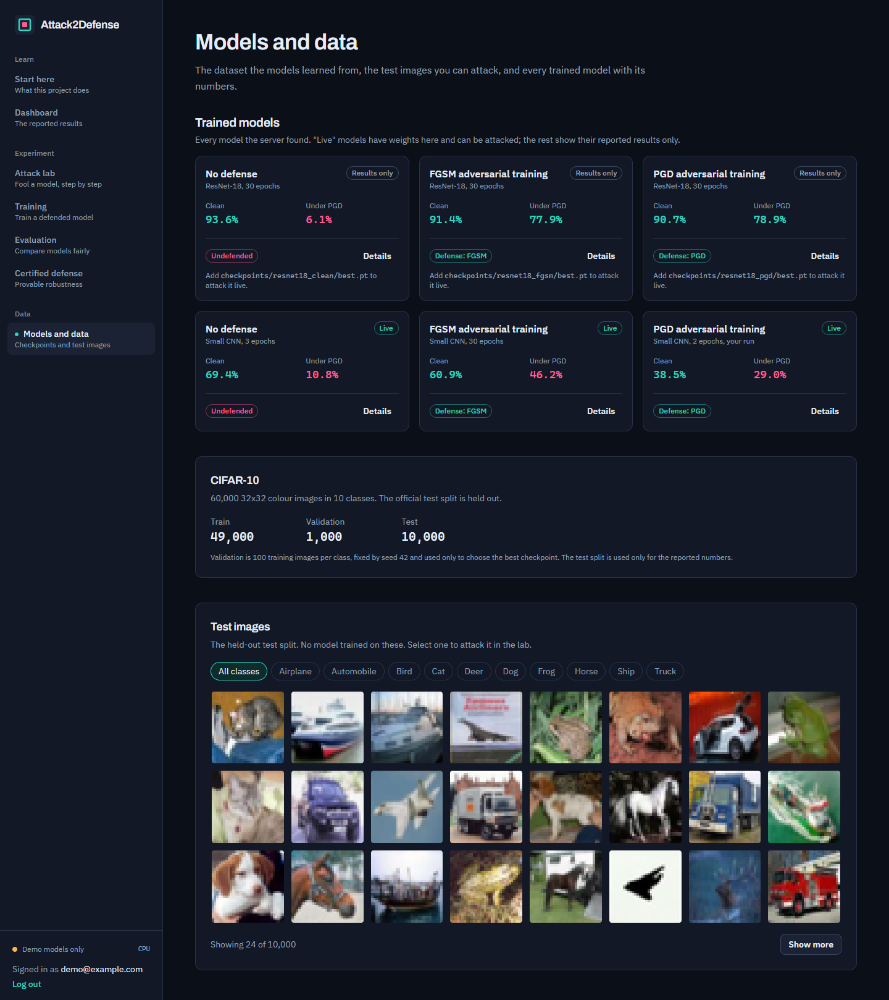
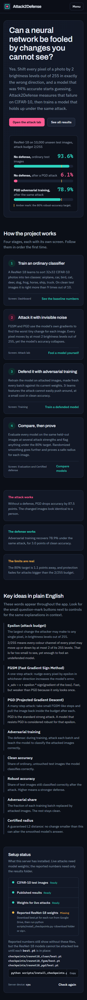

# User guide

This guide walks through every screen of the Attack2Defense web app. To install and start it, see the [README](../README.md#run-the-app).

The app answers one question: **can a neural network be fooled by changes you cannot see, and can it be trained not to be?** It follows four stages, each with its own screen:

1. **Train an ordinary classifier** (Training, "No defense")
2. **Attack it** with invisible noise (Attack lab)
3. **Defend it** with adversarial training (Training, "PGD training")
4. **Compare** the models fairly (Evaluation), and optionally **prove** robustness (Certified defense)

Colour always means the same thing: **teal** is clean images or a defense that held, **pink** is an attack or a model that was fooled, and **amber** is the 80% robustness target or a warning. Every "?" next to a term opens a plain-English definition; it also works with the keyboard (Tab to it, Escape to close).

**Light or dark.** Use the Dark / Light switch at the bottom of the sidebar (on a phone, the sun or moon button next to Menu). The app starts in your system's setting and remembers your choice. Colours keep the same meaning in both themes.

## Accounts

The Start here guide, the Dashboard, Models and data, and the Certified defense explanations are public. Running attacks, training, evaluation and certification uses server compute, so they need an account: an email and a password of at least 8 characters, stored only on this server. Screens that need an account show a "login" chip in the sidebar.

## Start here

The first time you open the app, it lands here. The top of the page shows the project's result in three bars: the undefended ResNet-18 is 93.6% accurate on ordinary test images, drops to 6.1% under a PGD attack, and recovers to 78.9% with PGD adversarial training. The amber mark is the 80% target.

Below that are the four stages, each linking to its screen, three takeaways, a glossary, and the **setup status**.

### Setup status

The checklist tells you what this server can do:

| Check | If it is missing |
| --- | --- |
| CIFAR-10 test images | The API downloads them on first use (about 170 MB) |
| Published results | Nothing can be shown; restore the `results/` folder |
| Weights for live attacks | Train a model on the Training screen, or run the CPU demo command |
| Reported ResNet-18 weights | The reported numbers still show, but those models cannot be attacked live. Download each `best.pt` and run `python scripts/install_checkpoints.py <folder or zip>` ([details](checkpoints.md)) |

The sidebar dot summarises the same thing: green is ready, amber means demo models only, red means the API is offline. Click it to jump to the checklist.

## Dashboard

The reported results, readable without logging in.

- **Four headline numbers**: clean accuracy, accuracy under attack without a defense, accuracy under attack with the defense, and the distance to the target.
- **Attack examples**: real test images before and after the attack. The "No defense" tab shows the model being fooled; the defended tab shows it holding.
- **Results table**: every reported model, with clean, FGSM and PGD accuracy and whether it met the target. "Live" means the weights are installed and the model can be attacked.
- **Stronger attacks**: accuracy as the attack budget grows past the 2/255 the models were trained for. Robustness fades as the budget grows; that is expected.
- **Zero-shot benchmark**: ImageNet ResNet-50 and ViT-B/16 on CIFAR images, if that experiment was run.

## Attack lab

Fool a model, step by step.

1. **Choose a model.** Only models with weights are listed. Tick **Compare with another model** to attack two models with the same image and settings, for example the baseline and the defended model side by side.
2. **Choose an image.** Pick a class and click **New image** for a different test picture, or open "Or upload your own photo" to attack any picture (it is resized to 32x32).
3. **Set the attack.**
   - **FGSM** takes one step. **PGD** takes many small steps and is much stronger.
   - **Strength** is the attack budget epsilon: how many brightness levels (out of 255) each pixel may change. 2/255 is what the models were trained against and is invisible; 16/255 starts to be visible.
   - **Advanced PGD settings**: number of steps, step size and random start. The defaults follow Madry et al.

With **Update automatically** ticked (the default), the attack re-runs whenever a setting changes. Untick it to run only when you click **Run attack**.

### Reading the result

- The **verdict banner** says whether the model was fooled.
- **Original / Attacked / Change** shows the clean image, the attacked image (they should look the same), and the change amplified so you can see it. The heatmap shows where the change is largest.
- **What just happened** explains the result in words, including how the model's confidence in the true class changed.
- **Measurements**: the largest single-pixel change (L-infinity, never more than the budget), the total change (L2), and how quickly PGD succeeded step by step.
- **Batch check** attacks 16 random test images at once and reports the success rate, a better guide than a single image.

## Training

Train a model with a chosen defense. Finished models appear in the Attack lab and Evaluation automatically, visible only to you.

| Defense | What it does | Cost |
| --- | --- | --- |
| No defense | Ordinary training; the baseline attacks break | 1x |
| FGSM training | Trains on one-step attacks made on the fly | About 2x |
| PGD training | Trains on multi-step attacks; slowest, most robust | Grows with the PGD steps (about 4x at 3 steps) |
| Noise training | Trains on Gaussian noise, for the certified defense | 1x |

**How long**: *Quick demo* (Small CNN, 2 short epochs, about a minute on a CPU) and *Stronger demo* (6 longer epochs) are presets. *Custom* opens every setting. The estimate under the form uses this server's device.

- **Training attack budget**: the epsilon the model learns to resist. The reported runs use 2/255.
- **Adversarial share of each batch**: below 100% keeps some clean images in every batch, which keeps more clean accuracy but gives less robustness.

While a run is going, its card shows the progress bar and two charts per epoch: validation accuracy (clean, FGSM, PGD; higher is better) and training loss (lower is better). You can stop a run; it halts after the current batch. When it finishes, it is tested on 200 held-out images and offers buttons to attack it or compare it.

The demo runs are short. They show the *method* working (PGD accuracy rising with training), not the reported numbers, which took 30 epochs of ResNet-18 on a GPU.

## Evaluation

A fair comparison: every selected model faces the same images and the same attacks at each budget.

1. Tick up to six **models to compare**.
2. Pick **how thorough**: *Quick check* (100 images, 3 budgets) or *Thorough* (500 images, 5 budgets, 20 PGD steps).
3. Optionally change the **attack budgets**, the **pass mark** (robust accuracy below it is flagged) and the PGD steps.

The report shows an amber summary of everything below the pass mark, a table with "below" badges, and a chart of accuracy against attack budget (solid lines are PGD, dashed are FGSM). Download it as CSV or JSON for a report.

Only models with weights are listed, because an evaluation attacks every model live. The reported numbers for results-only models are on the Dashboard.

## Certified defense

Attacks can only show that a model *failed*; a cleverer attack might still exist. Randomized smoothing gives a guarantee instead: "no change of total size below r can alter this answer, whatever the attacker does."

1. Choose a model. Noise-trained models give the largest guarantees.
2. Set **noise sigma** to the value the model was trained with (0.25 by default).
3. Choose *Quick* (50 images, 100 noisy copies each) or *Careful* (100 images, 500 copies).

The result is a curve: the share of images that are both correct and certified at each radius r. The radius is measured in L2 (total change), so it is not directly comparable with the L-infinity accuracy on the other screens. If the GPU run included the optional certification cell, its curves are shown below your own; the current results set does not include one.

## Models and data

Browse what is installed.

- **Model cards** show each model's defense, clean and PGD accuracy, and whether it is *Live* (weights installed) or *Results only*. Open one to see its training settings, its per-epoch history and its attack example grid.
- **Dataset** describes CIFAR-10: 10 classes, 32x32 images, 49,000 training, 1,000 validation and 10,000 test images.
- **Test images** can be filtered by class. **Attack image #N** opens it in the Attack lab.

## On a phone

The layout adapts to narrow screens: the sidebar becomes a **Menu** drawer, and every form stacks into one column.

## Troubleshooting

| Symptom | Cause and fix |
| --- | --- |
| Red dot, "API offline" | The backend is not running. Start it with `python -m uvicorn backend.app.main:create_app --factory --port 8000` |
| Attack lab says no models can be attacked | No weights are installed. Train a Quick demo, or install the ResNet-18 weights |
| "Results for 'resnet18_pgd' exist, but its best.pt is missing" | Same as above, for one model |
| A job stays "Queued" | Another job is running; jobs run one at a time |
| A job failed after a server restart | Jobs that were running when the server stopped are marked failed. Start it again |
| Logged out unexpectedly | Tokens last 12 hours. Log in again |
| Training is very slow | ResNet-18 on a CPU is about 10x slower than the Small CNN. Use the Small CNN, or a GPU |
